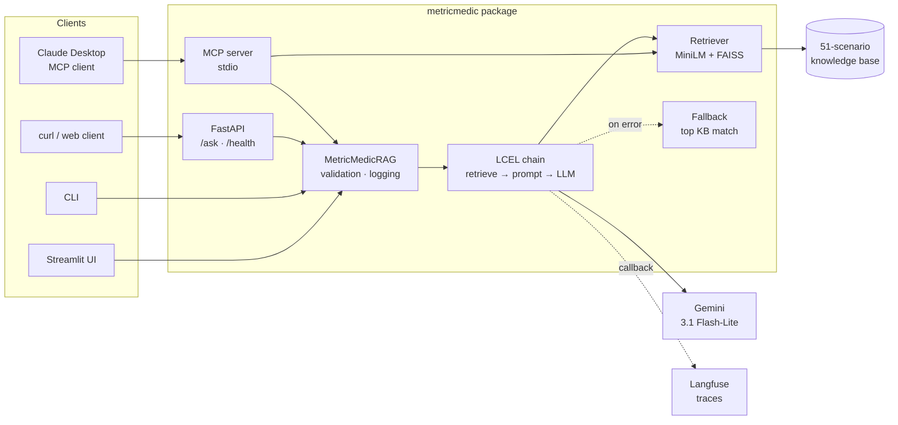
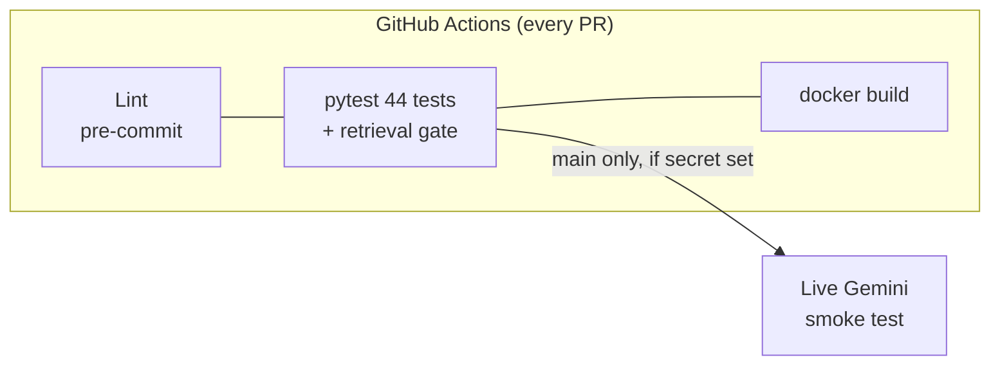

# MetricMedic: RAG API with Tracing, Evals and MCP

[](https://github.com/sgaind-data/metricmedic-chatbot/actions/workflows/ci.yml)


MetricMedic is a retrieval-augmented assistant that diagnoses **data and metric problems**
(revenue mismatches, double counting, row explosions after joins, timezone drift, and similar).
It answers from a curated knowledge base of 51 troubleshooting scenarios, cites its sources,
and declines questions outside that scope.

This project takes it from a Streamlit prototype to a production-style service:

| Area | What it has |
|---|---|
| **RAG core** | Python package, FAISS cosine search over MiniLM embeddings, LangChain retriever + LCEL chain with a deterministic fallback |
| **API** | FastAPI (`/ask`, `/health`), input validation, request IDs, structured JSON logs |
| **Deployment** | Multi-stage Docker image (CPU-only torch, model baked in, non-root, healthcheck) and docker compose |
| **Observability** | Langfuse tracing of every request: retrieval and LLM spans, latency, tokens, sessions, tags |
| **Evaluation** | 40-question golden dataset, retrieval metrics (hit@k, MRR) and RAGAS answer-quality scores |
| **Agent access** | MCP server exposing the retriever and the full pipeline to Claude Desktop or any MCP client |
| **CI** | GitHub Actions: pre-commit lint, 44 tests, a retrieval quality gate, a Docker build and an optional live LLM smoke test |

Everything runs on free tiers: the Gemini API free tier, Langfuse Cloud Hobby, a local Ollama judge for evals,
and GitHub Actions on a public repo.

---

## Architecture



**Request flow:** the question is validated (1–2000 characters, top_k 1–10) → embedded with
`all-MiniLM-L6-v2` → the top-k scenarios are found by cosine similarity in FAISS → they are formatted into a
grounded prompt → Gemini writes the answer → the answer comes back with its sources. If Gemini fails
(a rate limit or an outage), the chain falls back to the best knowledge-base match instead of returning an
error, and logs a warning.



---

## Results

All numbers are real outputs from `evals/`, and each one names the file it comes from. The golden dataset
has 40 questions (35 single-scenario, 1 ambiguous, 1 multi-scenario, 3 out-of-scope). Quality metrics are
scored on the **37 in-scope** questions; the 3 out-of-scope ones test the decline threshold.

| Layer | Result | Source |
|---|---|---|
| Retrieval (37 questions) | hit@3 0.838 · MRR 0.719 | `evals/results/retrieval_report.md` |
| Answer quality (RAGAS, 37 questions) | faithfulness 0.746 · context recall 0.743 · answer relevancy 0.532 | `evals/results/ragas_report.md` |
| Latency and cost (Langfuse, 60 requests) | p50 1,446 ms · p95 2,554 ms · ~727 tokens and $0.0005 per query at list price | `evals/results/langfuse_bench_bench-20261111-1733.json` |

### Retrieval (deterministic, no LLM, 37 in-scope questions)

| Metric | Score |
|---|---|
| hit@1 | 0.595 |
| **hit@3** | **0.838** |
| hit@5 | 0.892 |
| MRR | 0.719 |
| recall@3 | 0.550 |
| In-scope top-1 similarity (min / mean) | 0.333 / 0.522 |
| Out-of-scope top-1 similarity (max) | 0.142 |

The gap between in-scope (≥ 0.333) and out-of-scope (≤ 0.142) similarity is what sets the **0.25
out-of-scope threshold** used by the MCP server. CI fails if that gap ever closes.

### Answer quality (RAGAS, 37 in-scope questions)

Answers come from Gemini 3.1 Flash-Lite. The judge is a local `qwen2.5:7b` model running in Ollama.

| Metric | Score | What it measures |
|---|---|---|
| Faithfulness | 0.746 | Are the answer's claims supported by the retrieved context? |
| Context recall | 0.743 | Does the retrieved context contain what the reference answer needs? |
| Context precision | 0.541 | Is the relevant context ranked near the top? |
| Answer relevancy | 0.532 | Does the answer address the question? |

**What the numbers say:**
- **Retrieval is the bottleneck.** The lowest-faithfulness answers (q17, q19, q22) are the same questions
  retrieval missed. When users describe a symptom ("my totals doubled") and the knowledge base uses jargon
  ("many-to-many join fan-out"), the right scenario doesn't reach the top 3, and the LLM then has nothing
  correct to ground on.
- **Answer relevancy is understated.** Its distribution is bimodal, with 9 exact zeros. RAGAS gives a
  zero when the judge reads hedged wording ("likely", "check whether") as noncommittal. This is a known
  bias of using an LLM as the judge, not a sign of off-topic answers.
- **All 3 out-of-scope questions were declined correctly.**

### Experiment: hybrid retrieval (BM25 + dense, RRF), not adopted

All 6 retrieval misses were vocabulary gaps, so I tested hybrid search: BM25 keyword scores fused with the
dense ranking by Reciprocal Rank Fusion (`metricmedic/hybrid.py`). Parameters were standard defaults fixed
before the run (BM25 k1=1.2, b=0.75; RRF k=60), and the adoption rule was written down first: hit@3 and
MRR must both improve, with no previously correct question lost.

| Metric (37 questions) | Dense (kept) | Hybrid | Change |
|---|---|---|---|
| hit@1 | 0.595 | 0.568 | -0.027 |
| hit@3 | 0.838 | 0.865 | +0.027 |
| recall@3 | 0.550 | 0.606 | +0.056 |
| MRR | 0.719 | 0.714 | -0.005 |

Hybrid fixed q17 and q22 but broke q11, and ranked the right answer first less often. On 37 questions,
one question is 2.7 points, so the hit@3 gain is a net of one question. Under the pre-registered rule,
**dense retrieval stays**. Source: `evals/results/retrieval_comparison.md`
(`python -m evals.compare_retrieval`). Next: a cross-encoder reranker, judged on a larger held-out set.

### Latency, cost and footprint

Measured from Langfuse traces, not local timers: 60 requests through the full pipeline with
`python -m evals.langfuse_bench`, tag `bench-20261111-1733`, 0 fallbacks.

| | Value |
|---|---|
| End-to-end p50 | 1,446 ms |
| End-to-end p95 (nearest rank) | 2,554 ms |
| Max | 83,166 ms (1 of 60 requests) |
| Tokens per 100 queries | 72,737 (48,757 input / 23,980 output) |
| Cost per 100 queries | $0.0482 at Gemini list price, as computed by Langfuse ($0 billed on the free tier) |
| Retrieval (embed + FAISS) | ~90 ms in a sample trace |
| Docker image | 528 MB compressed / 2.29 GB on disk |

The single 83 s request doesn't move p50 or p95, but it is why a request timeout is on the next-steps list.

---

## Quickstart

**Requirements:** Python 3.12, plus a free Gemini API key from [Google AI Studio](https://aistudio.google.com/)
(no card needed).

```bash
git clone https://github.com/sgaind-data/metricmedic-chatbot.git
cd metricmedic-chatbot
python3.12 -m venv .venv && source .venv/bin/activate
pip install -r requirements-dev.txt && pip install -e .
cp .env.example .env          # then add GEMINI_API_KEY (Langfuse keys are optional)
```

```bash
python -m metricmedic "Why does my revenue not match finance?"   # CLI
uvicorn metricmedic.api.main:app --reload                         # API on :8000
streamlit run app.py                                              # chat UI
pytest -q                                                         # 44 tests, no API calls
```

### API

```bash
curl -s localhost:8000/health
curl -s -X POST localhost:8000/ask \
  -H "Content-Type: application/json" \
  -d '{"question": "My row count exploded after a join", "top_k": 3}'
```

```json
{
  "answer": "Likely issue: Many-to-many join ...",
  "sources": [{"issue": "Many-to-many join causing duplicates", "score": 0.69, "...": "..."}],
  "used_fallback": false
}
```

Every response carries an `X-Request-ID` header. The ID also appears in the logs and in the Langfuse trace,
so one request can be followed end to end. Invalid input returns `422`. Unexpected errors return a generic
`500` with the request ID and never a stack trace.

### Docker

```bash
docker compose up --build        # serves on localhost:8000, reads .env at runtime
```

- Multi-stage build with CPU-only PyTorch, which keeps the image far smaller than with CUDA wheels.
- The embedding model is baked in at build time and loaded with `HF_HUB_OFFLINE=1`, so there are no
  downloads at startup.
- It runs as a non-root `appuser`, has a `HEALTHCHECK` on `/health`, and is limited to 2 GB of memory in compose.
- Secrets are never baked into the image. `.env` is excluded by `.dockerignore` and injected at runtime.

---

## Observability (Langfuse)

Add `LANGFUSE_PUBLIC_KEY`, `LANGFUSE_SECRET_KEY` and `LANGFUSE_BASE_URL` to `.env`. Every request is then
traced as a tree of spans: retriever → prompt → Gemini, with latency, token counts, and the model name.

- **Tags** identify the entry point: `api`, `cli`, `streamlit`, `mcp`, `eval`, `ci-smoke`.
- **Sessions** group a Streamlit conversation (`chat-<id>`), or a caller-supplied `session_id` on `/ask`.
- **Metadata** carries the request ID, so a log line and its trace can be joined.
- Tracing is optional. With no keys, or with `LANGFUSE_TRACING_ENABLED=false` (as in tests and CI), it is a no-op.

## Evaluation

```bash
pip install -r requirements-eval.txt
python -m evals.retrieval_eval                 # free and deterministic
python -m evals.generate_answers               # 37 Gemini calls, resumable, rate-limit aware
ollama pull qwen2.5:7b && python -m evals.ragas_eval
python -m evals.langfuse_bench run --n 60      # 60 traced Gemini calls (needs Langfuse keys)
python -m evals.langfuse_bench stats --tag bench-<from the run>   # p50 / p95 / tokens / cost
```

- `evals/golden_dataset.jsonl` has 40 hand-checked questions written in user language (not copied from the KB),
  covering all 51 scenarios, plus ambiguous, multi-scenario and out-of-scope cases.
- Reports are written to `evals/results/` as both JSON and Markdown.
- The golden set is used **only for measurement**. Nothing was tuned against it, to avoid data leakage.

## MCP server

The retriever is exposed as a [Model Context Protocol](https://modelcontextprotocol.io) server, so an agent
such as Claude Desktop can call it as a tool.

| Type | Name | Purpose |
|---|---|---|
| Tool | `search_troubleshooting_kb` | Raw top-k KB matches with scores and an `in_scope` flag. No LLM call, no cost. |
| Tool | `ask_metricmedic` | The full RAG answer. Declines without calling the LLM when the question is out of scope. |
| Resource | `metricmedic://issues` | The list of all 51 issues the KB covers |

```bash
metricmedic-mcp                               # stdio (for Claude Desktop)
npx @modelcontextprotocol/inspector metricmedic-mcp   # interactive testing
```

Claude Desktop config (`claude_desktop_config.json`):
```json
{ "mcpServers": { "metricmedic": { "command": "/absolute/path/to/.venv/bin/metricmedic-mcp" } } }
```

## CI (GitHub Actions)

| Job | Runs on | What it checks |
|---|---|---|
| Lint | every PR and push | 9 pre-commit hooks: ruff lint + format, YAML/TOML checks, large files, private keys |
| Tests + retrieval gate | every PR and push | 44 pytest tests with fake LLMs (no API calls), then `evals.smoke --retrieval` |
| Docker | every PR and push | The production image still builds |
| Live smoke test | `main` / manual only | 3 real questions through Gemini, only if the `GEMINI_API_KEY` secret is set |

The **retrieval quality gate** fails the build if hit@3 drops below 0.80 or MRR below 0.65 (the baseline
minus a margin), or if the 0.25 out-of-scope threshold stops separating in-scope from out-of-scope questions.
A change that quietly makes retrieval worse cannot be merged.

---

## Project layout

```
metricmedic/            core package
  retriever.py          MiniLM + FAISS, embedding cache
  lc_retriever.py       LangChain BaseRetriever adapter
  chain.py, prompts.py  LCEL chain, grounded prompt, fallback
  pipeline.py           MetricMedicRAG: validation, tracing, logging
  tracing.py            Langfuse handler, sessions, tags, flush
  api/                  FastAPI app and schemas
  mcp_server.py         MCP tools and resource
evals/                  golden dataset, retrieval + RAGAS evals, CI smoke test
tests/                  44 tests (unit, chain, API, tracing, dataset, MCP)
Dockerfile, docker-compose.yml, .github/workflows/ci.yml
```

## Design decisions

- **Embeddings run locally (MiniLM), with a hosted LLM.** Retrieval is free, fast (~90 ms) and deterministic, which is what
  makes the CI quality gate possible. Only generation uses an API.
- **The chain falls back instead of failing.** On a free tier, rate limits are normal. The user still gets the most relevant
  KB guidance, flagged with `used_fallback: true`, and the failure is logged and traced.
- **The prompt is sent as a single human message.** Gemini's v1 API rejects system instructions. A regression test locks this in.
- **The LLM judge runs locally.** RAGAS needs hundreds of judge calls, which a 500-requests-per-day free tier can't cover.
  A local 7B judge is free and repeatable, but noisier than a frontier model, so its scores are best read as relative.
- **Question text is never logged.** Only lengths, latency, and request IDs, in case user questions contain sensitive data.

## Limitations and next steps

- **Retrieval recall.** Hybrid BM25 + dense was tested and not adopted (see Results). Next is a cross-encoder
  reranker, judged on a larger held-out question set, for the gap between symptom wording and KB jargon
  (q10, q17, q19, q22, q27 and q30 currently miss).
- **Out-of-scope handling in the API.** The 0.25 threshold is applied in the MCP server. The next step is to apply it in
  the API pipeline too, to save an LLM call on off-topic questions.
- **Eval tooling.** Migrate to the newer RAGAS metric API and add a stronger judge when one is available for free.
- **Request timeout.** Cap the LLM call (and its retries) so a rare slow request falls back instead of
  taking 83 s, as 1 of 60 benchmark requests did.

## License

MIT
